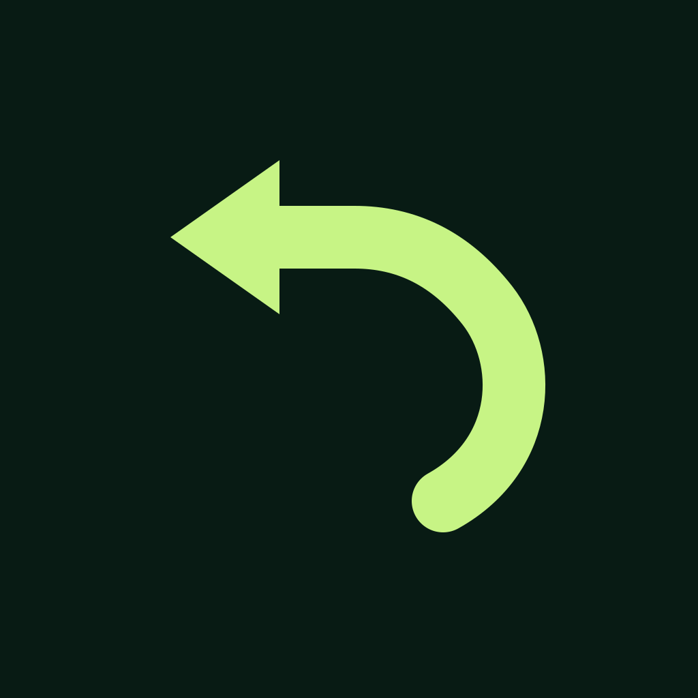

<div align="center">



# Go Back

### Make time for what matters.

A calm, local-first focus companion for Android. Build intentional focus sessions, understand your screen time, and keep your study plans moving — without sending your personal productivity data to an account or cloud service.

[](https://www.android.com/)
[](https://kotlinlang.org/)
[](https://developer.android.com/compose)
[](LICENSE)
[](https://github.com/kr-ndv/Go-Back/actions/workflows/build-apk.yml)

</div>

---

## About

Go Back is an Android focus and digital-wellbeing app designed to help you be more deliberate with your attention. Start a focused session, track how your time is spent, organise study goals, and review your progress — all in one simple workspace.

The active Android app is built with **Kotlin, Jetpack Compose and Material 3**. Personal notes, study data, focus history and preferences are stored locally on your device.

> **Development status:** Go Back is actively evolving. The core focus, study-planning and tracking experience is available. App-blocking behaviour and notification design are still being refined and should be considered experimental until their device-level testing is complete.

## Features

| Area | What you can do |
| --- | --- |
| **Focus mode** | Run countdown sessions, Pomodoro cycles or a stopwatch. Add session notes and tags, pause and resume, and use saved presets. |
| **Focus goals** | Set a daily focus target and follow your progress from the home dashboard. |
| **Screen-time insights** | Review usage summaries, screen-time trends and session history. Usage Access is required for device-usage statistics. |
| **Study planner** | Organise subjects, track syllabus progress, add exams and schedule recurring focus sessions. |
| **Personal notes** | Create and manage notes locally alongside your focus and study workflow. |
| **Home-screen tools** | Use the focus widget and Quick Settings tile for at-a-glance progress and quick access. |
| **Personalisation** | Choose light, dark or system appearance, accent palettes, profile details and focus preferences. |
| **Backup & restore** | Export your local data to JSON and restore it on the device. |

### Focus Shield — experimental

Go Back includes optional Accessibility-based app and content-blocking controls, plus per-app usage-limit rules. Their behaviour varies with Android version, manufacturer customisations, permissions and the target app's interface. This area is under active refinement; do not rely on it as a security control or as guaranteed device-wide enforcement.

## Preview

The current native UI is being refined. The screenshots retained in `docs/screenshots/` are historical previews from an earlier app build and are **not representative of the current Kotlin app**, so they are intentionally not shown as current product screenshots.

## Getting started

### Requirements

- Android Studio with Android SDK Platform 35
- JDK 17
- Android 7.0 (API 24) or newer

### Open the project

1. Clone this repository.
2. Open the `android/` directory in Android Studio.
3. Allow Gradle sync to finish.
4. Build and run the `app` configuration on an emulator or Android device.

Or build from a terminal:

```bash
cd android
./gradlew testDebugUnitTest
./gradlew assembleDebug
```

The debug APK is generated at:

```text
android/app/build/outputs/apk/debug/app-debug.apk
```

The debug APK is unsigned for Play Store distribution. A release build must be signed with a maintainer-controlled key. **Never commit keystores, signing passwords or private keys.**

## Permissions

Some capabilities need permissions to be granted explicitly in Android Settings:

| Permission | Used for |
| --- | --- |
| **Usage Access** | Reading device app-usage statistics and calculating screen-time totals. |
| **Accessibility Service** | Optional focus-shield and app/content-blocking behaviour. |
| **Notifications** | Focus timer, schedule, exam and usage-related alerts. |
| **Exact alarms** | Scheduling timer completion and time-sensitive reminders where Android permits them. |

You can revoke these permissions at any time. If a permission is unavailable, the related feature may show limited or no data.

## Privacy & data

- Focus sessions, notes, study records and preferences are stored locally using Room / SQLite.
- JSON backup and restore is initiated by the user.
- Go Back does not require an account to use its core local features.
- The optional update checker contacts the public GitHub Releases API.
- Accessibility and Usage Access are sensitive Android capabilities. Enable them only if you understand and want the related functionality.

## Limitations

- Blocking is **best-effort**, not device-owner enforcement. It cannot guarantee that every app, browser or content surface will be blocked.
- Go Back cannot prevent a user from disabling Accessibility, revoking permissions or uninstalling the app.
- Screen-time accuracy depends on Android's UsageStats data and the device's reporting behaviour.
- Background execution, alarms and notifications may be affected by battery optimisation and manufacturer-specific Android behaviour.

## Project structure

```text
Go-Back/
├── android/
│   └── app/src/
│       ├── main/java/com/goback/focus/
│       │   ├── data/       # Room database, entities and DAOs
│       │   ├── logic/      # Focus and scheduling logic
│       │   ├── receiver/   # Alarm and boot receivers
│       │   ├── service/    # Timer, maintenance and accessibility services
│       │   ├── ui/         # Compose screens, components and theme
│       │   └── widget/     # Home-screen widget
│       └── test/           # JVM unit tests
├── assets/                 # App artwork
├── docs/                   # Release notes and test documentation
└── README.md
```

## Build automation

The [Build standalone Android APK](.github/workflows/build-apk.yml) workflow is configured for the `fix/notes-description-icon-build` branch and can also be started manually from the **Actions** tab. It compiles a debug APK and can run JVM unit tests. Successful builds upload an APK artifact retained for 14 days.

This is a **debug build**, not a signed production release. The workflow does not publish to Google Play.

## Contributing

Contributions, bug reports and thoughtful feature suggestions are welcome.

1. Check the existing issues before opening a new one.
2. Describe the Android version and device behaviour when reporting a bug.
3. For permission-dependent features, include which permissions were enabled.
4. Keep changes focused and include tests where practical.

Please avoid including personal data, private backups, signing credentials or device identifiers in issues and pull requests.

## Documentation

- [Release checklist](docs/RELEASE_CHECKLIST.md)
- [Release test matrix](docs/RELEASE_TEST_MATRIX.md)
- [Production readiness notes](docs/PRODUCTION_READINESS.md)

## Licence

Go Back is open source under the [MIT License](LICENSE).

---

<div align="center">

**Go Back · Your time, with intention.**

</div>
