# Go Back

<p align="center">
  <strong>A calmer way to get back on track.</strong><br />
  A local-first focus and productivity app for Android, built with React Native, Expo, and TypeScript.
</p>

<p align="center">
  <a href="https://github.com/kr-ndv/Go-Back/actions/workflows/ci.yml"></a>
  <a href="https://github.com/kr-ndv/Go-Back/actions/workflows/android-build.yml"></a>
  <a href="https://github.com/kr-ndv/Go-Back/releases"></a>
  
  
  
</p>

---

## About

Go Back brings everyday study and focus tools into one place, with a clean **Material 3 Expressive-inspired** interface, flexible color themes, and a privacy-first approach. It is designed to help you plan the day, build consistency, and return to what matters without needing an account or cloud sync.

> **Project status:** Public beta. The latest UI refresh has been merged into `main`. The refreshed public APK is being rebuilt; check [Releases](https://github.com/kr-ndv/Go-Back/releases) for the currently published build.

## What you can do

| Area | What it offers |
| --- | --- |
| **Today dashboard** | A quick overview of your day and progress across your study and productivity tools |
| **Tasks** | Organize work with priorities and optional due dates |
| **Notes** | Write and search personal notes by title or content |
| **Focus timer** | Countdown, stopwatch and guided Pomodoro modes; preset/custom durations, short/long breaks, session recovery, completion notifications, tags, notes and session history |
| **Focus schedule** | Create repeating weekly reminders with day, local time and session duration; reminders never start a timer or block apps automatically |
| **Syllabus tracker** | Organize subjects and chapters and track completion progress |
| **Exams** | Keep exam countdowns and timetable details close at hand |
| **Habits & goals** | Track daily habits, streaks, and progress toward goals |
| **Screen-time insights** | View Android usage statistics after granting Usage Access; locally classify apps as productive, distracting or neutral |
| **App-blocking tools** | Select installed apps for whole-app blocking, plus experimental YouTube/Instagram channel and Shorts/Reels rules using Android Accessibility |
| **Home-screen widget** | Quick actions for Focus, Tasks, Exams, and Habits |
| **Personalization** | Light, dark, or system appearance; multiple accent palettes; local profile |
| **Backup & restore** | Export and restore app data using versioned JSON backups; files are not encrypted |

## Screenshots

Explore the app screens below. These are screenshots from the current app, shown in its Forest Lime dark theme.

<table>
  <tr>
    <td align="center" width="50%"><strong>Today dashboard</strong><br />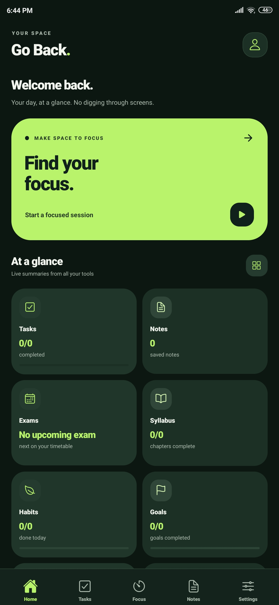</td>
    <td align="center" width="50%"><strong>Tasks</strong><br />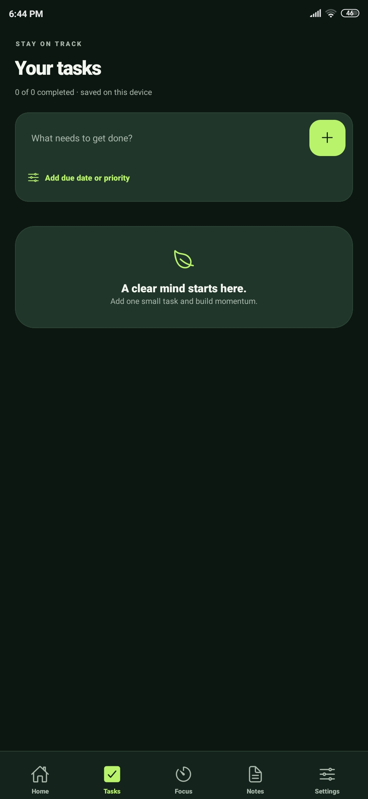</td>
  </tr>
  <tr>
    <td align="center" width="50%"><strong>Focus timer</strong><br />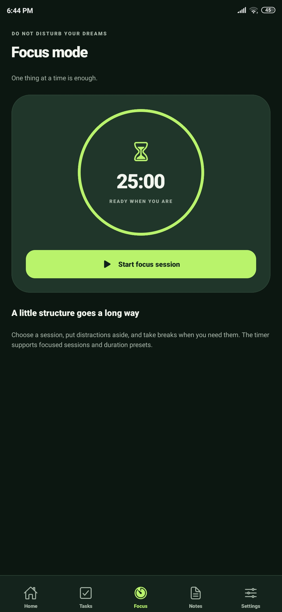</td>
    <td align="center" width="50%"><strong>Personal notes</strong><br />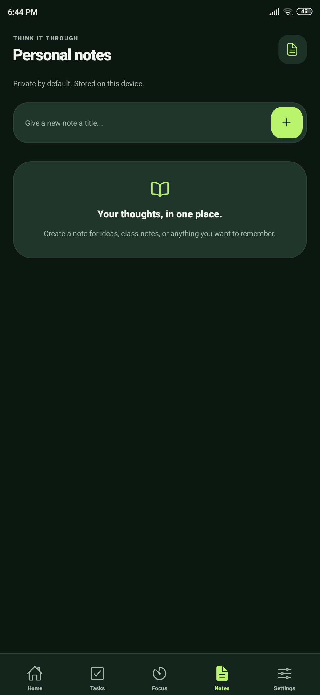</td>
  </tr>
  <tr>
    <td align="center" width="50%"><strong>Settings and color palettes</strong><br />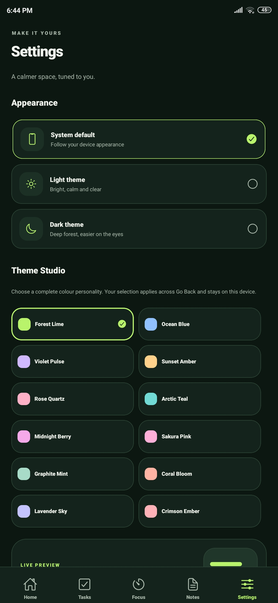</td>
    <td align="center" width="50%"><strong>Exam planner</strong><br />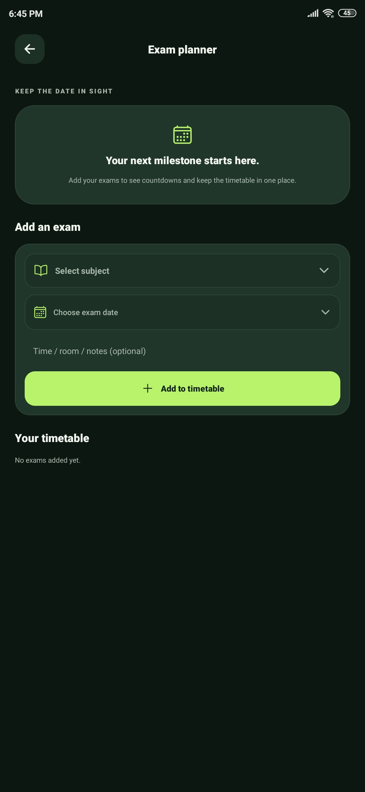</td>
  </tr>
  <tr>
    <td align="center" width="50%"><strong>Syllabus tracker</strong><br />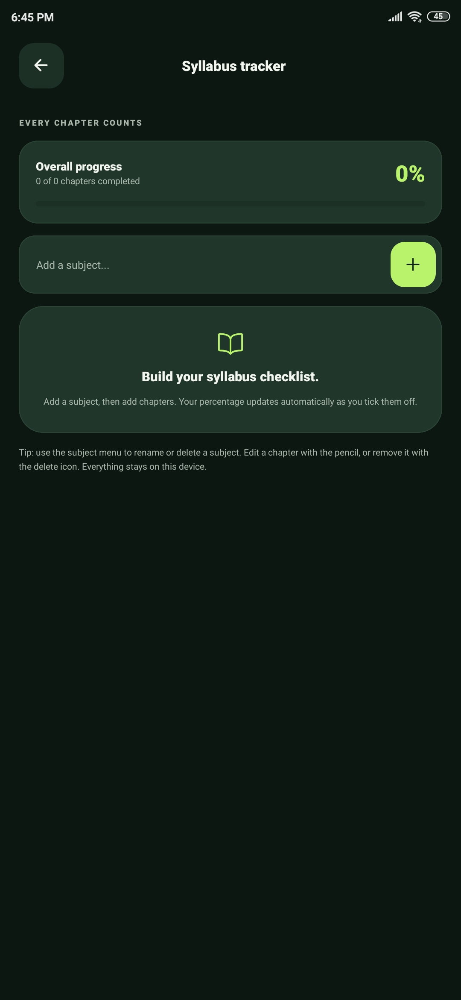</td>
    <td align="center" width="50%"><strong>Daily habits</strong><br />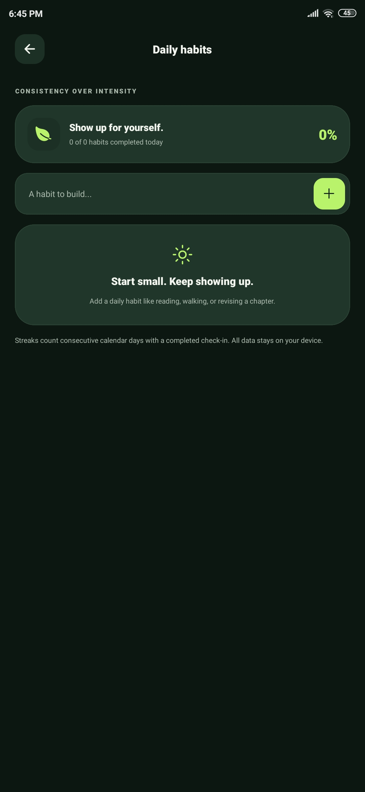</td>
  </tr>
  <tr>
    <td align="center" width="50%"><strong>Goals</strong><br />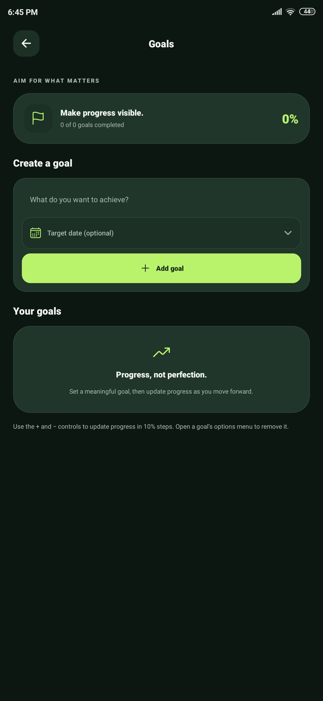</td>
    <td align="center" width="50%"><strong>Screen-time insights</strong><br />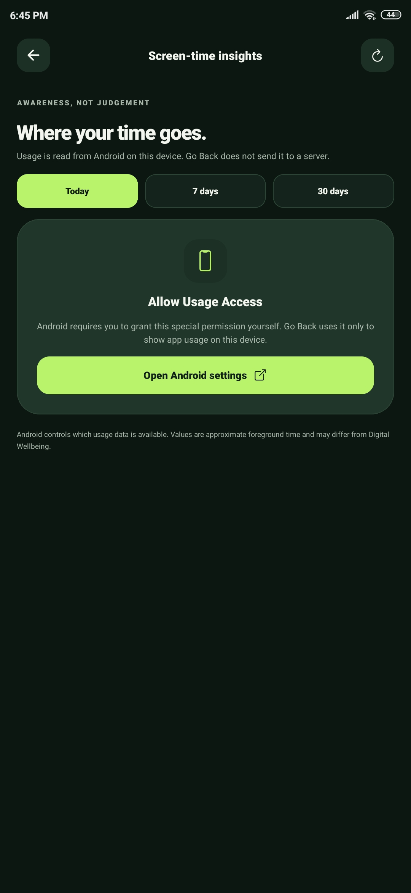</td>
  </tr>
  <tr>
    <td align="center" width="50%"><strong>App blocking (experimental)</strong><br />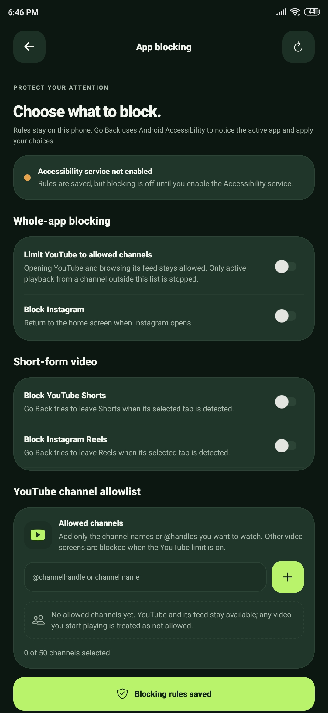</td>
    <td align="center"><em>More improvements are in progress.</em></td>
  </tr>
</table>

## Design

- Material 3 Expressive-inspired visual language with rounded surfaces and clear hierarchy
- 12 color palettes, including Forest Lime, Ocean Blue, Violet Pulse, Sunset Amber, Rose Quartz, and more
- Light, dark, and system appearance modes
- Responsive focus timer layout and accessible touch targets
- Reduced-motion and semantic color considerations

## Get the app

**[Browse Go Back releases](https://github.com/kr-ndv/Go-Back/releases)** for published beta builds and their checksums.

For a test build from GitHub Actions:

1. Open the [Actions tab](https://github.com/kr-ndv/Go-Back/actions).
2. Select **Android Standalone APK** or **Android APK Build**.
3. Open a successful run and download its APK artifact.
4. Verify the SHA-256 checksum when one is provided.

The public beta APK is test-signed and intended for evaluation, not a production app-store release. Back up your local data before uninstalling or switching builds.

## Run locally

### Requirements

- Node.js LTS
- npm
- Android Studio and Android SDK for local Android builds

### Install and start

```bash
git clone https://github.com/kr-ndv/Go-Back.git
cd Go-Back
npm install
npx expo start
```

To run on an Android device or emulator:

```bash
npx expo run:android
```

### Validate changes

```bash
npm run typecheck
npm test -- --runInBand
```

The app uses Expo Router and SQLite. Native Android functionality is generated through Expo prebuild/config plugins; an Expo Go session does not provide all native capabilities.

## Privacy by design

- Core app data is stored locally on the device using SQLite.
- Screen-time insights use Android's UsageStatsManager after you explicitly grant Usage Access in Android settings.
- Experimental blocking reads visible accessibility text on supported apps to apply local rules; this processing is intended to happen on-device.
- Screen-time app classifications and focus session tags/notes are stored locally in the app database.
- No AI service, cloud backend, advertising SDK, or analytics service is currently configured.

**Backup note:** exported backups are plain JSON. Keep them private and store them somewhere secure.

## Known limitations

Go Back is still in beta, and some Android-specific behaviors vary by device and OS version:

- Accessibility-based blocking and Shorts/Reels detection are experimental and can be imperfect.
- Screen-time reports reflect Android UsageStats data; app categories are user-defined labels, not an automatic judgment of productivity.
- Background timer notifications and screen-time reporting need continued real-device validation.
- The home-screen widget and background behavior should be tested on the target device.
- Backups are not encrypted, and device verification is not implemented.

Grant Usage Access or Accessibility permission only if you choose to use the corresponding feature. You can use the core planning and focus features without enabling app blocking.

## Roadmap

See **[docs/ROADMAP.md](docs/ROADMAP.md)** for implementation phases and known platform limitations.

## Contributing

Issues and focused pull requests are welcome. Please include:

- A clear description of the problem or proposed change
- Steps to reproduce bugs
- Device and Android version for device-specific issues
- Screenshots or short recordings for UI changes, where useful

Before opening a pull request, run the type-check and tests listed above.

## License

No license file is currently present in this repository. Unless a license is added, standard copyright restrictions apply; please open an issue before reusing or redistributing the code.

---

<p align="center">
  <sub>Built to help you pause, refocus, and go back to what matters.</sub>
</p>
