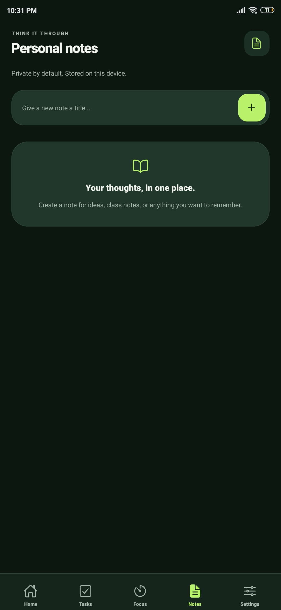
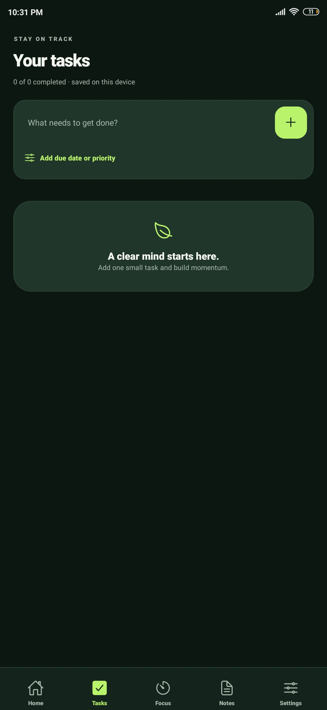
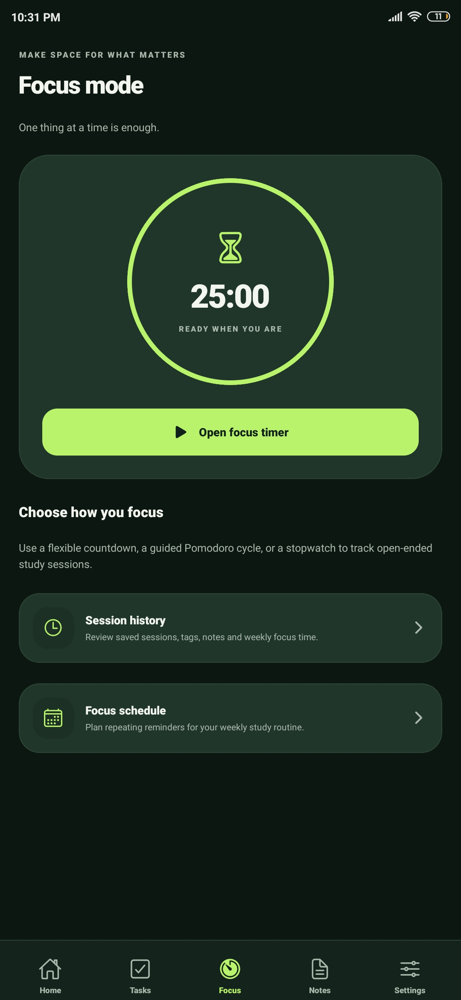
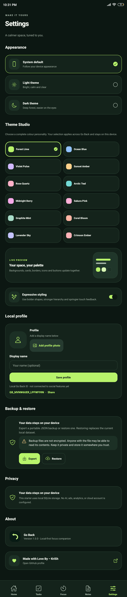
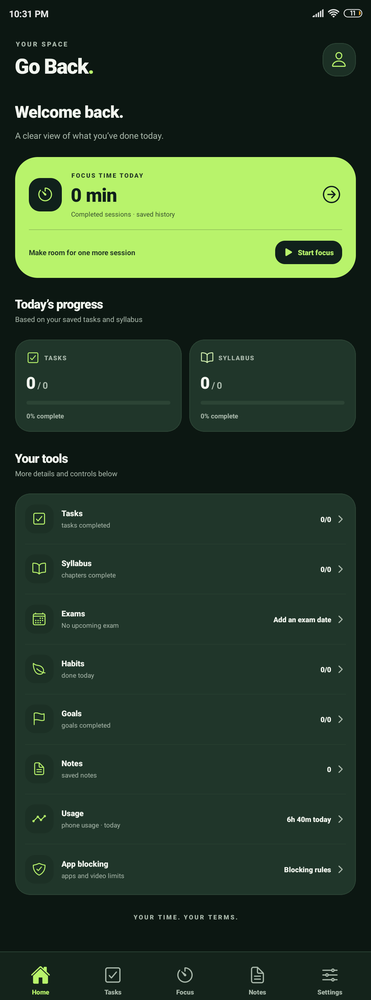
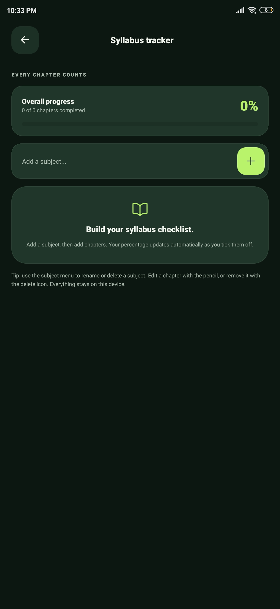

# Go Back

**A calm, all-in-one focus and productivity companion for Android.**

Go Back helps you be more intentional with your time. Bring your tasks, notes, study plans, focus sessions, and screen-time awareness together in one place—so you can spend less time getting distracted and more time moving forward.

The app is designed around a simple idea: build better habits through clarity, consistency, and focused work.

## Features

- **Home dashboard** — Get an at-a-glance view of your focus time, tasks, study progress, and productivity shortcuts.
- **Focus tools** — Use a countdown timer, stopwatch, or Pomodoro sessions, with session history and persistent timer notifications.
- **App blocking during focus** — Select apps to restrict while a focus session is active, helping reduce distractions.
- **Tasks and personal notes** — Organise what needs to get done and keep useful thoughts in one place.
- **Study and exam planning** — Track syllabus progress and organise exam preparation.
- **Screen-time insights** — Review device usage and classify apps as productive, distracting, or neutral.
- **Goals and daily habits** — Set personal goals and build routines with a clearer view of your progress.
- **Focus scheduling** — Plan focus sessions around your day.
- **Personalisation** — Choose appearance options and customise the app experience.
- **Local profile and backup** — Manage your local app profile and export or restore supported app data.

> **Platform note:** Go Back is an Android-focused app. Some features depend on Android permissions and device behaviour. Usage insights require Usage Access; focus-time app blocking requires the relevant accessibility permission. Availability and reliability can vary by Android version, app, and device manufacturer.

## Screenshots

| | |
|---|---|
|  |  |
|  |  |
|  |  |

## Project status

Go Back is actively developed. Builds distributed through the repository's Releases page may be beta or testing builds, so check the release notes before installing. Not every planned or experimental capability should be considered production-ready.

For the latest implementation notes and planned work, see:

- [Future feature roadmap](FUTURE_ROADMAP.md)
- [Production readiness checklist](docs/PRODUCTION_READINESS.md)
- [Release notes and downloads](https://github.com/kr-ndv/Go-Back/releases)

## Installation

1. Open the [Go Back Releases](https://github.com/kr-ndv/Go-Back/releases) page.
2. Choose the release you want to test.
3. Download its Android APK asset, if one is attached.
4. Install the APK on your Android device. Android may ask you to allow installation from the app used to download it.

Use the release notes for version-specific limitations and installation guidance. Back up important data before changing builds.

## Development

Go Back is built with **React Native**, **Expo**, and **TypeScript**, using Expo Router for navigation.

### Requirements

- Node.js and npm
- Android development environment for local Android builds
- Expo CLI through the project scripts

### Setup

Clone the repository and install dependencies:

```bash
git clone https://github.com/kr-ndv/Go-Back.git
cd Go-Back
npm install
```

Start the Expo development server:

```bash
npm start
```

Run on Android:

```bash
npm run android
```

Run the type check:

```bash
npm run typecheck
```

Run tests:

```bash
npm test
```

Build an Android preview APK with EAS:

```bash
npm run build:apk
```

Some native functionality requires a development build or a rebuilt APK; it may not work inside Expo Go.

## Privacy and permissions

Go Back includes features that need access to certain Android capabilities. The app explains relevant permissions when they are needed.

- **Usage Access** is used to read app-usage information for screen-time insights and related features.
- **Accessibility permission** is used for focus-session app-blocking functionality.
- **Notifications** are used for focus-session status, reminders, and timer alerts.

Grant only the permissions needed for the features you choose to use. Exported backups may contain personal app data; store them securely and do not share them publicly.

## Feedback and contributions

Found a bug or have an idea? Please [open an issue](https://github.com/kr-ndv/Go-Back/issues) with clear reproduction steps. For bugs, include your device model, Android version, app version, and relevant screenshots or logs when possible.

Before making larger changes, review the project roadmap and current implementation notes so that work stays aligned with the project's direction.

## Links

- **Repository:** https://github.com/kr-ndv/Go-Back
- **Releases:** https://github.com/kr-ndv/Go-Back/releases
- **Issues:** https://github.com/kr-ndv/Go-Back/issues

---

*Go Back — make time for what matters.*
