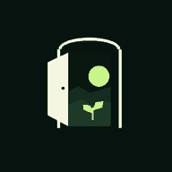

# Go Back

<p align="center">
  
</p>

<h1 align="center">Go Back</h1>

<p align="center">
  <strong>Your time. Your terms.</strong><br />
  A local-first Android focus and productivity app to help you plan your day, focus intentionally, and build better digital habits.
</p>

<p align="center">
  <a href="https://github.com/kr-ndv/Go-Back/actions/workflows/ci.yml"></a>
  <a href="https://github.com/kr-ndv/Go-Back/actions/workflows/android-build.yml"></a>
  <a href="https://github.com/kr-ndv/Go-Back/releases"></a>
  
  
  
</p>

<p align="center">
  <a href="https://github.com/kr-ndv/Go-Back/releases/latest">Get the latest beta</a> ·
  <a href="https://github.com/kr-ndv/Go-Back/issues">Report a bug</a> ·
  <a href="FUTURE_ROADMAP.md">Roadmap</a>
</p>

---

## Latest release: Beta 6

Go Back is currently distributed as a **beta pre-release**. Download the APK and read the release notes from the [GitHub Releases page](https://github.com/kr-ndv/Go-Back/releases). Beta builds are for evaluation and may contain bugs; they are not a stable app-store release.

## What Go Back includes

| Tool | What it does |
| --- | --- |
| **Home dashboard** | Shows today's focus time, task and syllabus progress, exam status, and shortcuts to tools. |
| **Tasks** | Add tasks with optional due dates and priorities. |
| **Personal notes** | Keep notes on-device, private by default. |
| **Focus timer** | Countdown timer, stopwatch, and guided Pomodoro sessions with persistent timer notification and session history. |
| **Session history** | Review sessions across Today, 7 days, 30 days, or a custom date range; set a daily focus-time goal. |
| **Focus schedule** | Create repeating weekly reminders using local time. A reminder does not start a timer or block apps automatically. |
| **Syllabus tracker** | Organize subjects and chapters and track completion. |
| **Exam planner** | Keep exam dates and timetable details in one place. |
| **Daily habits** | Track daily check-ins and streaks. |
| **Goals** | Set goals and update progress. |
| **Screen-time insights** | Read Android usage statistics and classify apps as productive, distracting, or neutral. |
| **Phone usage glance** | See today's total phone usage from the Home dashboard. |
| **App blocking** | Choose installed apps to block during focus sessions, with Android-specific permission requirements. |
| **Personalization** | System/light/dark appearance, multiple color palettes, optional local profile, and expressive styling. |
| **Backup & restore** | Export and restore local app data using JSON backup files. Backups are not encrypted. |

## Screenshots

The gallery below shows the app's Forest Lime theme and core screens. Images are stored in [docs/screenshots](docs/screenshots).

<table>
  <tr>
    <td align="center" width="50%"><strong>Home dashboard</strong><br /></td>
    <td align="center" width="50%"><strong>Tasks</strong><br /></td>
  </tr>
  <tr>
    <td align="center" width="50%"><strong>Focus</strong><br /></td>
    <td align="center" width="50%"><strong>Personal notes</strong><br /></td>
  </tr>
  <tr>
    <td align="center" width="50%"><strong>Settings & themes</strong><br /></td>
    <td align="center" width="50%"><strong>Exam planner</strong><br /></td>
  </tr>
  <tr>
    <td align="center" width="50%"><strong>Syllabus tracker</strong><br /></td>
    <td align="center" width="50%"><strong>Daily habits</strong><br /></td>
  </tr>
  <tr>
    <td align="center" width="50%"><strong>Goals</strong><br /></td>
    <td align="center" width="50%"><strong>Screen-time insights</strong><br /></td>
  </tr>
  <tr>
    <td align="center" width="50%"><strong>App blocking</strong><br /></td>
    <td align="center"><em>More screenshots and updates will be added as device verification progresses.</em></td>
  </tr>
</table>

## Install the beta

1. Open [GitHub Releases](https://github.com/kr-ndv/Go-Back/releases).
2. Choose the latest **Beta** pre-release and download its Android APK.
3. Open the downloaded APK on your Android device. If Android asks, allow installation from the browser or file manager you used.
4. Open Go Back and grant optional permissions only for features you choose to use.

**Before installing a different build:** back up important local data where possible. Uninstalling an app can remove its local data. Beta builds are test builds and may change between releases.

## Beta notes and limitations

- Go Back is in active beta testing. Real-device behavior can vary by Android version, manufacturer, notification settings, and battery restrictions.
- Usage insights require Android **Usage Access** permission.
- App blocking relies on Android Accessibility capabilities and may not work identically across apps or devices.
- **YouTube allowed-channel limiting is still testing and remains disabled** while reliability issues, including mini-player behavior, are investigated. Do not rely on it.
- Focus schedules send reminders; they do not automatically start sessions or block apps.
- Backups are plain JSON and **are not encrypted**. Keep exported files private.
- A passing CI build is not a substitute for testing the APK on a physical Android device.

Please report issues through [GitHub Issues](https://github.com/kr-ndv/Go-Back/issues) with your device model, Android version, steps to reproduce, and screenshots/logs where useful.

## Privacy

- Core planning data is stored locally on the device using SQLite.
- Usage insights use Android's UsageStats data after you grant Usage Access.
- App categories, notes, tasks, focus sessions, and schedules are intended to stay on-device.
- No cloud account is required for core features. Review permissions before enabling optional Android integrations.
- Exported backups are readable JSON files and should be stored securely.

## Run locally

### Requirements

- Node.js LTS and npm
- Android Studio and Android SDK for local Android builds

```bash
git clone https://github.com/kr-ndv/Go-Back.git
cd Go-Back
npm install
npx expo start
```

For a native Android build:

```bash
npx expo run:android
```

Validate changes before opening a pull request:

```bash
npm run typecheck
npm test -- --runInBand
```

Go Back uses Expo Router and SQLite. Expo Go does not provide every native Android capability used by the app.

## Project status and roadmap

This repository is moving through beta stabilization. Current work prioritizes reliability, data integrity, permissions, accessibility, privacy, and physical-device verification over adding features. See [FUTURE_ROADMAP.md](FUTURE_ROADMAP.md) for planned work and project rules.

## Contributing

Focused bug reports and pull requests are welcome. Please include reproduction steps and device/Android details for platform-specific issues. Please discuss significant feature changes before implementation; the project is currently under a feature freeze.

## License

No license file is currently present. Unless a license is added, standard copyright restrictions apply; please open an issue before reusing or redistributing the code.

---

<p align="center">
  <sub>Made with care by KriSh · Your time. Your terms.</sub>
</p>
